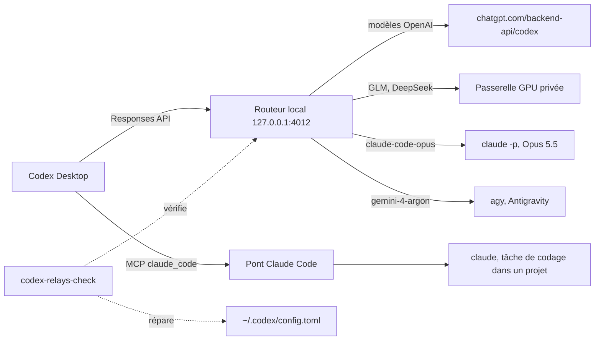

# Claude dans Codex Desktop

[](https://github.com/VynoDePal/codex-claude-relay/actions/workflows/ci.yml) [](LICENSE)

Ce dépôt contient la configuration complète qui permet d’utiliser **Claude (Opus 5.5, via Claude Code)** comme modèle dans le sélecteur de Codex Desktop, avec tous les outils de Codex : shell, édition de fichiers, connecteurs, navigateur intégré, Google Chrome, délégation.

Il contient aussi le connecteur **claude_code**, qui permet à n’importe quel modèle de Codex de déléguer une tâche de codage à Claude Code, et un contrôle automatique qui répare la configuration après les mises à jour de Codex Desktop.

## Ce que fait la configuration

| Fonction | Où |
|---|---|
| Modèle « Claude » dans le sélecteur de Codex, efforts low à max | [relay/claude_relay.py](relay/claude_relay.py) |
| Routeur local qui sert OpenAI, la passerelle GPU, Claude et Gemini sur 127.0.0.1:4012 | [relay/combined_proxy.py](relay/combined_proxy.py) |
| Compaction des longues conversations par Claude, avec résumé chiffré localement | [relay/claude_compaction.py](relay/claude_compaction.py) |
| Passage d’un modèle OpenAI à Claude en cours de conversation (récupération de l’historique local) | [relay/claude_history.py](relay/claude_history.py) |
| Conversion de l’historique Codex (outils ajoutés, types inconnus, recherche d’outils) | [relay/claude_tools.py](relay/claude_tools.py) |
| Catalogue d’outils allégé (813 000 → 215 000 caractères) | [relay/tool_catalog.py](relay/tool_catalog.py) |
| Délégation de tâches de codage à Claude Code (connecteur MCP) | [claude-code-bridge/](claude-code-bridge/) |
| Délégation à des exécutants GLM ou DeepSeek, le modèle de Codex restant manager (connecteur MCP) | [gpu-agents/](gpu-agents/) |
| Contrôle et réparation après les mises à jour de Codex Desktop | [relay-guard/](relay-guard/), [systemd/](systemd/) |
| Compétence de routage entre modèles | [skills/model-routing/](skills/model-routing/) |

Le détail de chaque mécanisme est dans [docs/fonctionnement-claude.md](docs/fonctionnement-claude.md).

## Architecture



Claude Code est lancé sans ses outils internes. Il reçoit les outils de Codex dans sa consigne et rend ses appels sous forme de sortie structurée ; c’est Codex qui les exécute, avec ses propres permissions. Plus de détails dans [docs/architecture.md](docs/architecture.md).

## Installation rapide

```bash
git clone git@github.com:VynoDePal/codex-claude-relay.git
cd codex-claude-relay
./scripts/install.sh
```

Le script copie les fichiers, installe les services systemd utilisateur, ajoute à `~/.codex/config.toml` les réglages manquants (après une sauvegarde) et lance les tests. Prérequis et étapes manuelles : [docs/installation.md](docs/installation.md).

## Vérifier que tout marche

```bash
curl -s http://127.0.0.1:4012/health
codex-relays-check
./scripts/run-tests.sh
```

En cas de problème : [docs/depannage.md](docs/depannage.md).

## Synchronisation automatique

Le dépôt suit la configuration active. `codex-relay-sync` copie dans le dépôt le relais, le pont Claude Code, la compétence, les scripts de `relay-guard/`, les réglages indispensables et les services systemd, en remplaçant le dossier personnel par `%h`, `~` ou `__HOME__`. Il vérifie l’absence de secrets, lance les tests, puis committe et pousse uniquement ces chemins. `README.md`, `docs/` et `scripts/` restent modifiés à la main.

- **Déclenchement :** `codex-relay-sync.path` dès qu’un fichier surveillé change (après 30 secondes, pour regrouper une série de modifications), et `codex-relay-sync.timer` toutes les heures pour rattraper un envoi manqué.
- **En cas d’échec** (secret détecté, tests ratés, envoi refusé) : rien n’est commité ou poussé, une notification apparaît et le détail est dans `~/.codex/relay-guard/last-sync.txt`.
- **Chemin du dépôt :** `~/.codex/relay-guard/sync-repo`, écrit par `./scripts/install.sh --sync`.

| Commande | Effet |
|---|---|
| `codex-relay-sync --dry-run` | affiche ce qui serait synchronisé |
| `codex-relay-sync --no-push` | committe sans pousser |
| `systemctl --user disable --now codex-relay-sync.path codex-relay-sync.timer` | arrête la synchronisation |

## Structure du dépôt

```
relay/               Routeur et relais (Python, aiohttp) + 214 tests unittest
claude-code-bridge/  Serveur MCP « claude_code » (délégation à Claude Code)
gpu-agents/          Serveur MCP « gpu_agents » (exécutants GLM/DeepSeek via Codex CLI) + 21 tests
relay-guard/         Contrôle automatique et réglages indispensables de config.toml
systemd/             Services utilisateur (routeur, relais GPU, contrôle)
skills/              Compétence Codex « model-routing »
config/              Extraits de config.toml et d’AGENTS.md
scripts/             Installation, tests, contrôle des secrets
docs/                Documentation
```

## Sécurité

- Aucun secret n’est versionné. Les jetons sont lus à l’exécution dans `~/.codex/auth.json`, `~/.codex/gateway.key` et `~/.codex/claude-selector/compaction.key`. Lancez `./scripts/check-secrets.sh` avant chaque commit.
- L’adresse de la passerelle GPU n’est pas versionnée : le routeur la lit dans `~/.codex/gpu-gateway.url` ou dans la variable `CODEX_GPU_GATEWAY_URL`. Sans elle, les modèles GPU sont simplement absents.
- Les chemins personnels et les identifiants de chats Codex sont remplacés avant chaque synchronisation, et `check-secrets.sh` bloque tout commit qui contiendrait un jeton, une adresse e-mail personnelle ou un nom d’hôte Tailscale.
- Le routeur n’écoute que sur 127.0.0.1 et exige le jeton de connexion Codex de l’utilisateur.

## Limites connues

Voir la section « Limites » de [docs/fonctionnement-claude.md](docs/fonctionnement-claude.md#limites).

## Contribuer

Les contributions sont bienvenues : signalement de bug, correction, amélioration de la documentation.

1. Ouvrez une issue qui décrit le problème ou la proposition. Pour un bug, indiquez la version de Codex Desktop (`cat /usr/lib/chatgpt/version`), celle de Claude Code (`claude --version`) et le message d’erreur.
2. Forkez le dépôt et créez une branche pour votre changement.
3. Lancez `./scripts/run-tests.sh` : les tests du relais et de `gpu-agents` doivent tous passer. Ajoutez un test pour tout changement de comportement.
4. Lancez `./scripts/check-secrets.sh` avant chaque commit. N’ajoutez ni jeton, ni adresse de passerelle, ni chemin personnel, ni identifiant de chat Codex.
5. Ouvrez une pull request qui explique le problème, le changement et la façon dont vous l’avez testé.

La GitHub Action [CI](.github/workflows/ci.yml) lance ces deux contrôles à chaque push et à chaque pull request ; une pull request doit être au vert pour être fusionnée.

Les dossiers `relay/`, `claude-code-bridge/`, `gpu-agents/`, `skills/model-routing/`, `relay-guard/` et `systemd/` sont synchronisés automatiquement depuis l’installation du mainteneur (voir [Synchronisation automatique](#synchronisation-automatique)). Une contribution qui les modifie est donc d’abord reportée dans cette installation, puis publiée par la synchronisation. `README.md`, `LICENSE`, `docs/`, `config/` et `scripts/` se modifient directement.

## Licence

Distribué sous licence MIT. Voir [LICENSE](LICENSE).
